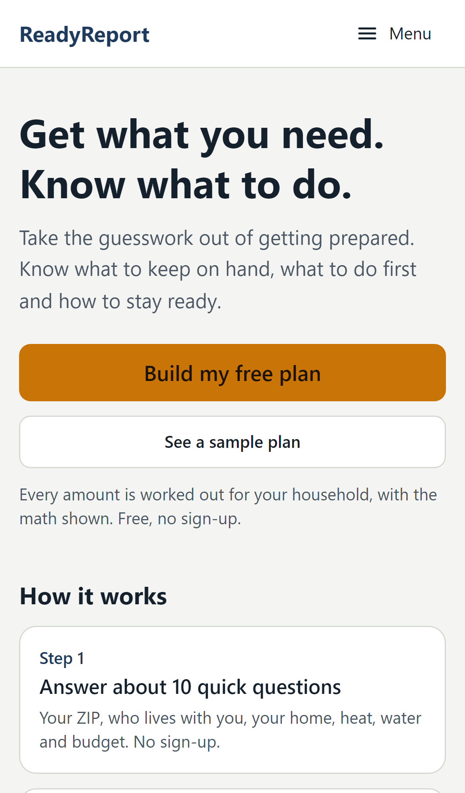
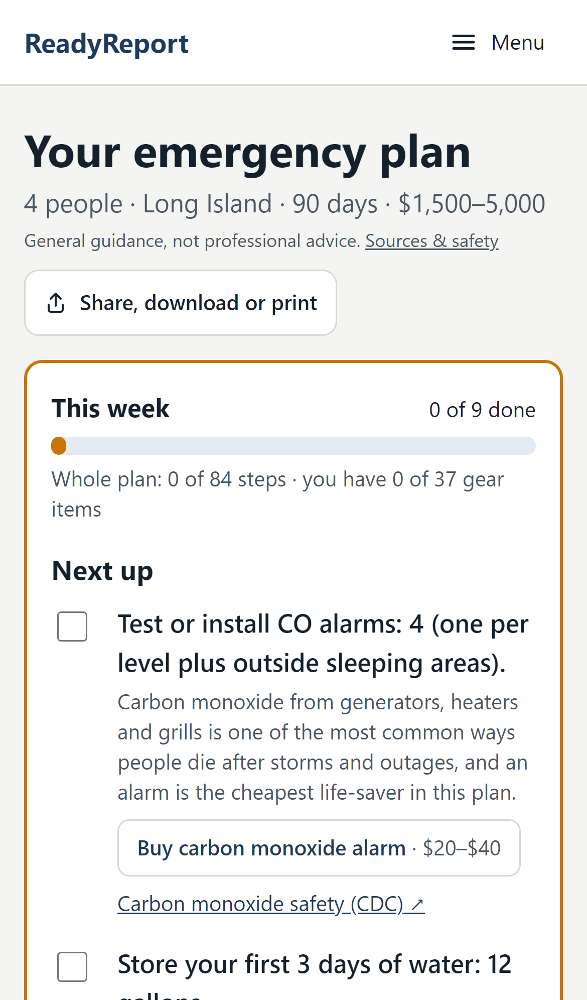
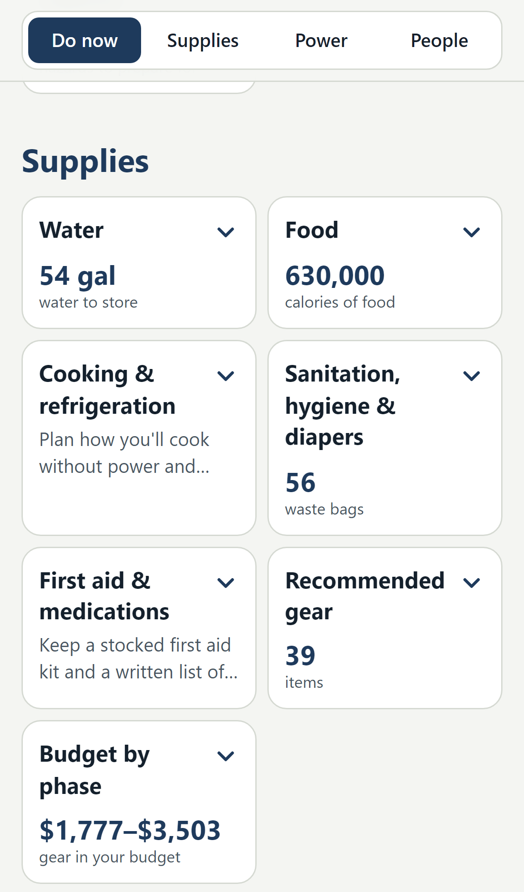
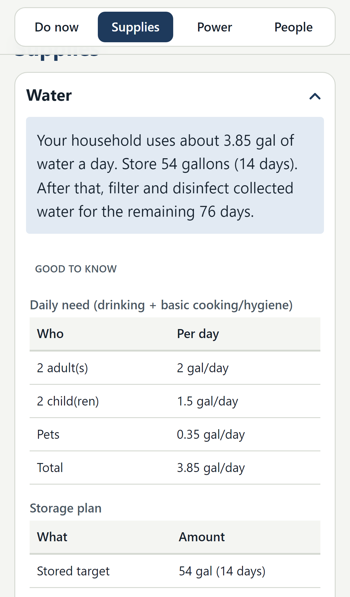
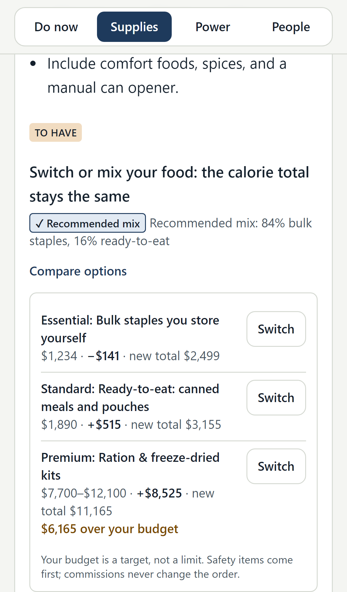
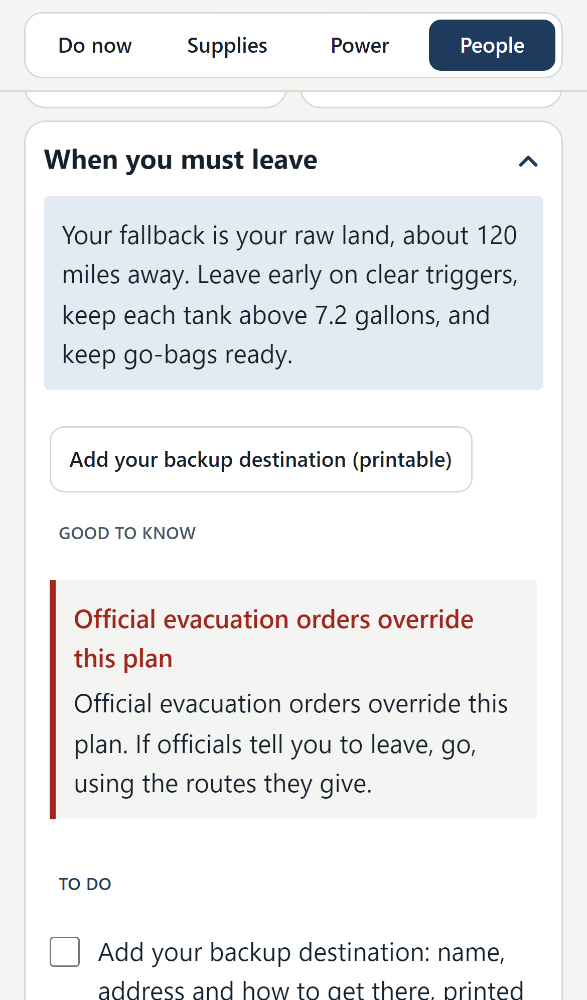
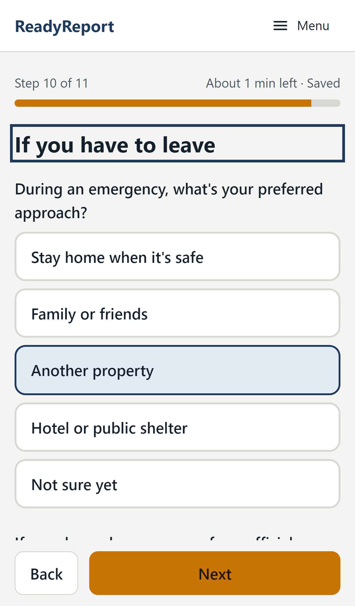
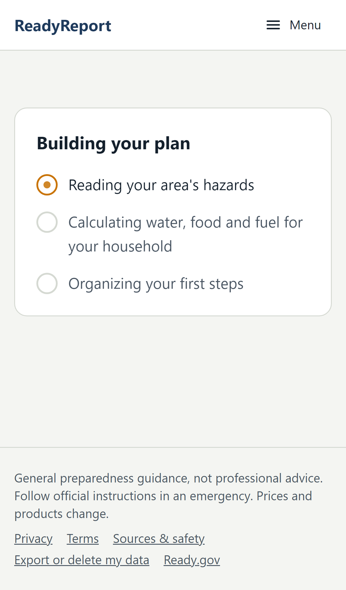

# Screenshots

iPhone 13 viewport (390×844), light and dark, taken by `scripts/screens.ts` against a local build with demo data. The originals live in `.data/screens/` (git-ignored, not in this repo); the light-mode copies listed at the end are in [screens/](screens/).

## Batch A: shell & front page (PR #7)

| Screen | Light | Dark |
| --- | --- | --- |
| Front page | `.data/screens/A/front-light.png` | `.data/screens/A/front-dark.png` |
| Front page, site menu open | `.data/screens/A/front-menu-light.png` | `.data/screens/A/front-menu-dark.png` |
| Help page | `.data/screens/A/help-light.png` | `.data/screens/A/help-dark.png` |
| Loading screen (three build stages) | `.data/screens/A/loading-light.png` | `.data/screens/A/loading-dark.png` |
| Plan page, save bar | `.data/screens/A/plan-save-bar-light.png` | `.data/screens/A/plan-save-bar-dark.png` |
| Plan page, Share / Download / Print menu | `.data/screens/A/plan-share-menu-light.png` | `.data/screens/A/plan-share-menu-dark.png` |
| Plan page, top | `.data/screens/A/plan-top-light.png` | `.data/screens/A/plan-top-dark.png` |
| Sources & safety page | `.data/screens/A/sources-light.png` | `.data/screens/A/sources-dark.png` |

## Batch B: questionnaire (PR #8)

| Screen | Light | Dark |
| --- | --- | --- |
| Questionnaire: evacuation questions | `.data/screens/B/q-evacuation-light.png` | `.data/screens/B/q-evacuation-dark.png` |
| Questionnaire: home features | `.data/screens/B/q-home-light.png` | `.data/screens/B/q-home-dark.png` |
| Questionnaire: usable storage | `.data/screens/B/q-storage-light.png` | `.data/screens/B/q-storage-dark.png` |
| Questionnaire: water filter type | `.data/screens/B/q-water-filter-light.png` | `.data/screens/B/q-water-filter-dark.png` |

## Batch C: plan content & layout (PR #9)

| Screen | Light | Dark |
| --- | --- | --- |
| Printable maintenance list | `.data/screens/C/maintenance-list-light.png` | `.data/screens/C/maintenance-list-dark.png` |
| Printable places page (nothing saved) | `.data/screens/C/places-light.png` | `.data/screens/C/places-dark.png` |
| Plan: chapter card grid | `.data/screens/C/plan-cards-light.png` | `.data/screens/C/plan-cards-dark.png` |
| Plan: Compare options | `.data/screens/C/plan-compare-light.png` | `.data/screens/C/plan-compare-dark.png` |
| Plan: Food section open | `.data/screens/C/plan-food-open-light.png` | `.data/screens/C/plan-food-open-dark.png` |
| Plan: When you must leave | `.data/screens/C/plan-leave-light.png` | `.data/screens/C/plan-leave-dark.png` |
| Plan: Stay ready (calendar, maintenance) | `.data/screens/C/plan-stay-ready-light.png` | `.data/screens/C/plan-stay-ready-dark.png` |
| Plan: Water section open | `.data/screens/C/plan-water-open-light.png` | `.data/screens/C/plan-water-open-dark.png` |

## Batch D: accounts track, flags on (PR #10)

| Screen | Light | Dark |
| --- | --- | --- |
| Overview food mix card (accounts on) | `.data/screens/D/d-food-card-light.png` | `.data/screens/D/d-food-card-dark.png` |
| Inventory page (accounts on) | `.data/screens/D/d-inventory-light.png` | `.data/screens/D/d-inventory-dark.png` |
| My places (accounts on) | `.data/screens/D/d-places-light.png` | `.data/screens/D/d-places-dark.png` |
| Overview / Inventory / Report tabs (accounts on) | `.data/screens/D/d-plan-tabs-light.png` | `.data/screens/D/d-plan-tabs-dark.png` |
| Reminders settings (accounts on) | `.data/screens/D/d-reminders-light.png` | `.data/screens/D/d-reminders-dark.png` |
| DIY tips box (tips on) | `.data/screens/D/d-tips-light.png` | `.data/screens/D/d-tips-dark.png` |

## Copied here (light mode, PNG)

| File | Screen | Size |
| --- | --- | --- |
| [screens/front-page.png](screens/front-page.png) | Front page (from `A/front-light.png`) | 163 KB |
| [screens/plan-top.png](screens/plan-top.png) | Plan page, top (from `A/plan-top-light.png`) | 205 KB |
| [screens/chapter-supplies-cards.png](screens/chapter-supplies-cards.png) | Plan: chapter card grid (from `C/plan-cards-light.png`) | 168 KB |
| [screens/chapter-water-section.png](screens/chapter-water-section.png) | Plan: Water section open (from `C/plan-water-open-light.png`) | 158 KB |
| [screens/compare-options.png](screens/compare-options.png) | Plan: Compare options (from `C/plan-compare-light.png`) | 209 KB |
| [screens/evacuation-when-you-must-leave.png](screens/evacuation-when-you-must-leave.png) | Plan: When you must leave (from `C/plan-leave-light.png`) | 191 KB |
| [screens/evacuation-questions.png](screens/evacuation-questions.png) | Questionnaire: evacuation questions (from `B/q-evacuation-light.png`) | 118 KB |
| [screens/loading-screen.png](screens/loading-screen.png) | Loading screen (three build stages) (from `A/loading-light.png`) | 132 KB |

### Front page

### Plan page, top

### Plan: chapter card grid

### Plan: Water section open

### Plan: Compare options

### Plan: When you must leave

### Questionnaire: evacuation questions

### Loading screen (three build stages)

